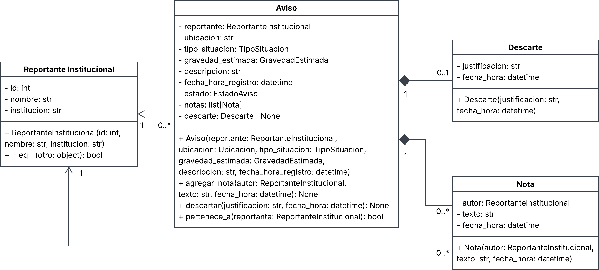
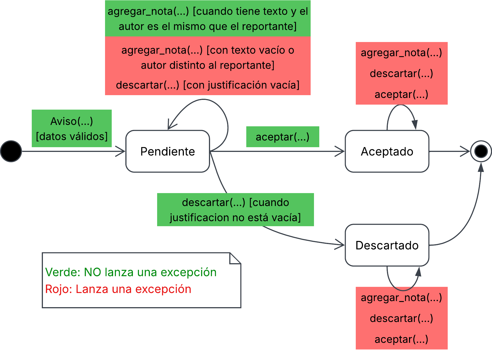

# Diseño Avance 1
## Diagrama de Clases

## Diagrama de Estados

## Trajetas CRC
| **Clase** | **Responsabilidades** | **Colaboradores** |
| --- | --- | --- |
| **Aviso** | Conocer y validar los datos originales del incidente (reportante, ubicación, tipo de situación, gravedad estimada, descripción y fecha/hora de registro) y mantener inalterables ante cualquier operación posterior. Iniciar en estado PENDIENTE. Incorporar notas únicamente si el aviso está pendiente y el autor es el mismo reportante que lo originó. Gestionar su descarte solo si está pendiente, pasando a estado DESCARTADO. Determinar si un aviso corresponde a un reportante institucional determinado. | ReportanteInstitucional; Nota; Descarte; Enums: EstadoAviso, TipoSituacion, GravedadEstimada. |
| **ReportanteInstitucional** | Conocer y validar al momento de su creación a su identificador único (id), nombre e institución. Determinar si representa al mismo reportante que otra instancia comparando su identidad. |  |
| **Notas** | Conocer y validar el contenido de la ampliación (texto), también conocer al autor y el momento en que se registró. Garantizar que sus valores sean inmutables una vez generada. | ReportanteInstitucional |
| **Descarte** | Conocer y validar su justificación y la fecha/hora en que se produjo. Garantizar que sus valores sean inmutables una vez generado. |  |

## Pregunta para la Defensa: ¿Quién verifica que el autor de la nota sea el reportante del aviso, el aviso o la capa que recibe al usuario autenticado? 
### Respuesta: 
La verificación de que el autor de una nota sea el reportante original del aviso es responsabilidad de la clase Aviso (modelo de dominio).
### Justificación:
La capa externa (aplicación o interfaz) solo se encarga de extraer la identidad del usuario desde la petición y pasársela a la entidad. En cambio, determinar si ese reportante puede ampliar un aviso específico es una regla de negocio propia de Aviso, ya que es el único que conoce quién lo creó, por lo tento el único que lo puede validar.